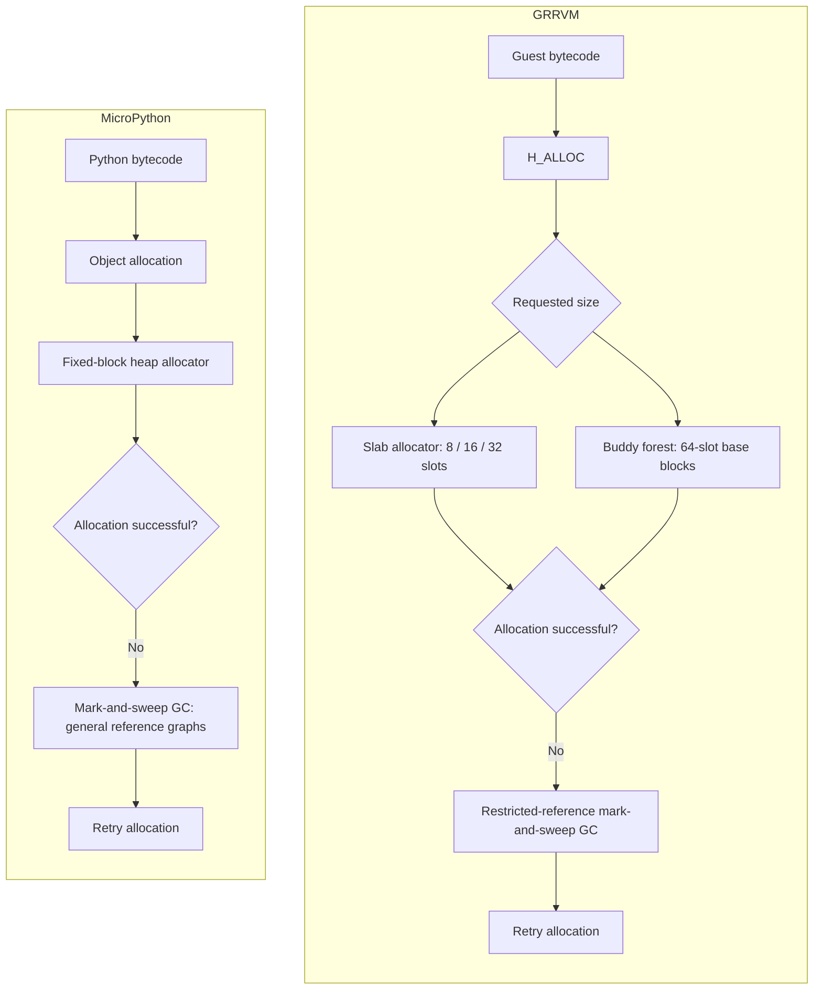
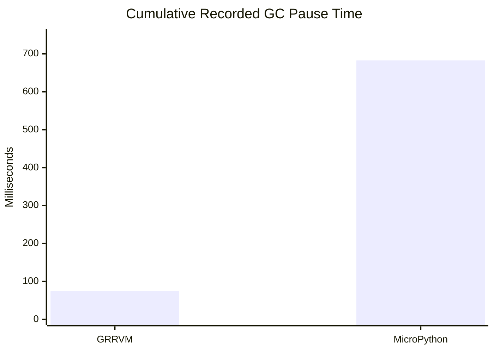
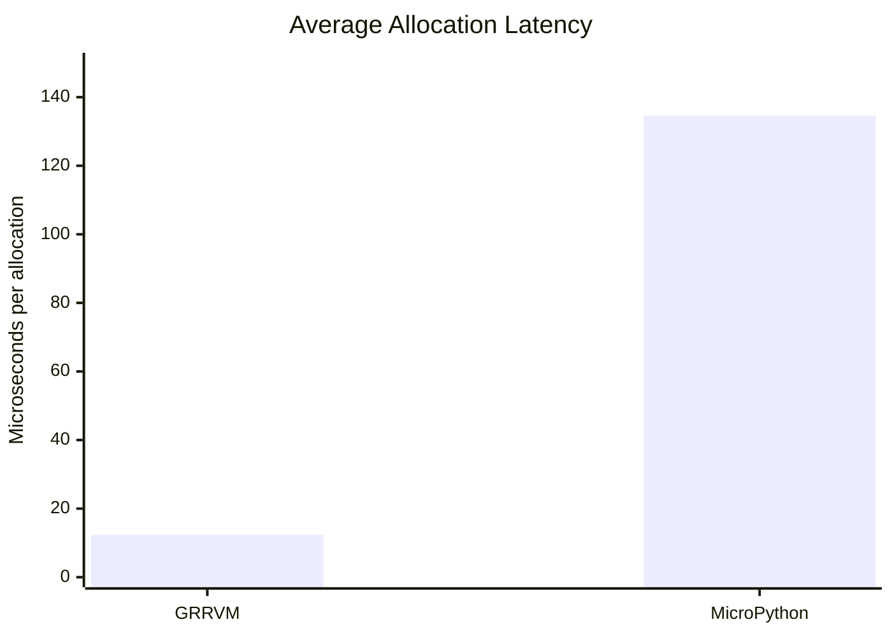
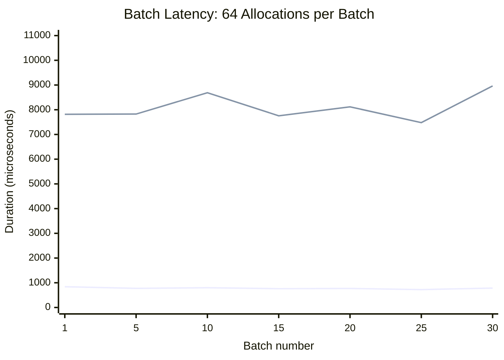

# GRRVM vs. MicroPython: Comparative Performance Analysis

**Evaluation platform:** Raspberry Pi Pico (RP2040)  
**Research variables:** Garbage collection (GC) jitter, allocation speed, and external fragmentation  
**Status:** Preliminary analysis based on one execution per runtime

## 1. Introduction

This analysis evaluates the measured performance characteristics of two intentionally different memory-management architectures: GRRVM's hybrid Buddy Forest–Slab allocator with restricted-reference mark-and-sweep garbage collection, and MicroPython's fixed-block allocator with mark-and-sweep collection.

The study does **not** aim to establish functional equivalence, demonstrate universal superiority, or propose GRRVM as a replacement for MicroPython. Instead, it investigates whether GRRVM's architectural choices produce measurable advantages or disadvantages in three specified areas:

1. **GC jitter:** Duration and variability of stop-the-world garbage collection pauses.
2. **Allocation speed:** Mean latency of memory allocation operations.
3. **External fragmentation:** Distribution of available memory relative to the largest allocatable free block.

Architectural differences are intentional and constitute part of the study's design. What must be controlled experimentally are the hardware, memory budgets, workload characteristics, timing methods, and measurement definitions where feasible.

## 2. Architectural Comparison

**Figure 1.** High-level allocation and garbage collection paths. The figure describes the relevant architectural distinction, not a claim that both implementations have identical execution paths in every configuration.

| Architectural characteristic | GRRVM | MicroPython |
|---|---|---|
| Allocation mechanism | Hybrid Buddy Forest–Slab | Fixed-block GC heap allocator |
| Garbage collection | Restricted-reference mark-and-sweep | General object-graph mark-and-sweep |
| Heap-stored references | Prohibited by VM design | Supported |
| Automatic collection trigger in these tests | Allocation failure | Allocation failure, emulated with `MemoryError` handling and `gc.collect()` |
| Compaction | None | None |
| Object capabilities | Flat scalar allocations; deliberately restricted | General Python object model |

GRRVM's heap reference restrictions simplify reachability analysis, but reduce the class of data structures that can be represented directly in guest heap memory. Its Buddy Forest allows a non-power-of-two total heap size, while introducing boundaries between independently managed trees.

## 3. Garbage Collection Jitter

The benchmark performed **2,000 allocation attempts** on each runtime, retaining three allocation anchors and discarding one transient allocation in each of 500 rounds. Both test configurations invoked collection in response to an allocation failure, although MicroPython did so through Python-level error handling rather than native GC-entry instrumentation.

### 3.1 Descriptive results

| Statistic | GRRVM | MicroPython | MicroPython / GRRVM |
|---|---:|---:|---:|
| Recorded GC pauses | 152 | 105 | — |
| Minimum pause | 0.043 ms | 5.731 ms | — |
| Mean pause | 0.491 ms | 6.501 ms | 13.25× |
| Median pause | 0.455 ms | 6.526 ms | 14.34× |
| P95 pause | 1.004 ms | 6.919 ms | 6.89× |
| P99 pause | 1.197 ms | 7.060 ms | 5.90× |
| Maximum pause | 1.415 ms | 7.104 ms | 5.02× |
| Standard deviation | ~0.272 ms | ~0.282 ms | — |
| Coefficient of variation | ~55.4% | ~4.3% | — |
| Total recorded GC pause time | 74.577 ms | ~682.58 ms | 9.15× |

**Figure 2. Mean and tail-latency comparison (milliseconds).**

```mermaid
xychart-beta
    title "GC Pause Latency: GRRVM vs MicroPython"
    x-axis [Mean, Median, P95, P99, Maximum]
    y-axis "Pause (ms)" 0 --> 8
    bar [0.491, 0.455, 1.004, 1.197, 1.415]
    bar [6.501, 6.526, 6.919, 7.060, 7.104]
```

*Series order: first GRRVM, then MicroPython. Lower is better.*

### 3.2 Collection frequency and cumulative pause time

| Measurement | GRRVM | MicroPython |
|---|---:|---:|
| Allocation attempts | 2,000 | 2,000 |
| Collections observed | 152 | 105 |
| Collections / allocation attempts | 7.60% | 5.25% |
| Cumulative measured GC time | 74.577 ms | ~682.58 ms |

**Figure 3.** Total measured pause time across the collections recorded in the respective workloads. These totals are not whole-program execution times.

### 3.3 Analysis

GRRVM recorded substantially shorter stop-the-world collection pauses than MicroPython in these traces. Its **maximum observed pause of 1.415 ms** was shorter than MicroPython's **minimum recorded pause of 5.731 ms**. Although GRRVM collected 47 more times, its cumulative measured pause time was approximately 89.1% lower.

One plausible explanation is GRRVM's restricted-reference architecture: the collector scans configured root locations and does not traverse arbitrary reference graphs inside the heap. MicroPython supports a more general object model, requiring different reachability behavior. This is an architectural hypothesis consistent with the observations, **not proof that the reference model alone caused the entire timing difference**.

MicroPython nevertheless exhibited a much smaller **coefficient of variation** (~4.3% versus ~55.4%). Thus, the preliminary data favor GRRVM in *absolute pause duration* and cumulative GC time, while MicroPython demonstrates *lower variability relative to its own mean*. GRRVM's worst recorded pauses were shorter, but its pauses were proportionally more variable.

The two runtimes did not necessarily receive the same random allocation-size sequence, and they represent payloads differently. The results are descriptive outcomes of the recorded runs, not controlled estimates of an intrinsic collector-only speedup.

## 4. Allocation Speed

The allocation-speed benchmark comprised **30 batches of 64 allocations**, totaling **1,920 timed allocations per runtime**. Requests corresponded to **64–2,040 bytes of requested payload**, derived from 8–255 GRRVM slots at 8 bytes per slot. Garbage collection and the freeing phase were outside the timed allocation window.

### 4.1 Descriptive results

| Measurement | GRRVM | MicroPython |
|---|---:|---:|
| Timed allocations | 1,920 | 1,920 |
| Mean batch duration | 791.10 µs | 8,617.27 µs |
| Median batch duration | 793.50 µs | 8,510.50 µs |
| Minimum batch duration | 724 µs | 7,479 µs |
| Maximum batch duration | 863 µs | 10,232 µs |
| Standard deviation across batches | ~33.48 µs | ~763.87 µs |
| Mean latency per allocation | **12.36 µs** | **134.64 µs** |
| Approximate throughput | ~80,900 allocations/s | ~7,427 allocations/s |

**Figure 4.** Mean allocation latency. Lower is better.

**Figure 5.** Selected batches (1, 5, 10, 15, 20, 25, and 30), shown to illustrate the scale difference. First series GRRVM; second series MicroPython. The table above uses **all 30 batches**, not merely those plotted.

### 4.2 Analysis

GRRVM recorded an average allocation latency of **12.36 µs**, compared with **134.64 µs** for MicroPython. The measured benchmark-path ratio is approximately **10.89×** in favor of GRRVM.

GRRVM uses slab size classes for smaller requests and buddy blocks for larger allocations. In contrast, MicroPython constructs `bytearray` objects through its interpreter and uses its fixed-block GC allocator. These pathways include different levels of interpreter and object-construction overhead. Accordingly, the result supports the statement that **GRRVM completed this allocation workload with lower measured latency**, but **does not establish that its allocator algorithm in isolation is 10.89× faster**.

Batch-level results were also comparatively stable, though 30 batches inside one execution should not be treated as 30 independent runtime trials.

## 5. External Fragmentation

The thesis defines external fragmentation as:

\[
E_f = 1 - \frac{L}{B_f + S_f}
\]

where:

- \(L\) is the largest allocatable free block among the buddy and slab pools.
- \(B_f\) is total free buddy capacity.
- \(S_f\) is total free slab capacity.

If \(B_f + S_f = 0\), fragmentation is **undefined**, not zero.

### 5.1 GRRVM observations

| GC collection | Pre-GC fragmentation | Post-GC fragmentation |
|---|---:|---:|
| 29 | Undefined (no free slots) | 64.44% |
| 92 | 79.81% | 64.35% |
| 95 | 54.93% | 83.46% |

| Post-GC characteristic | GC 29 | GC 92 | GC 95 |
|---|---:|---:|---:|
| Total free slots | 23,040 | 22,976 | 24,768 |
| Largest free block (slots) | 8,192 | 8,192 | 4,096 |

```mermaid
xychart-beta
    title "Selected Post-GC Free Capacity vs Largest Block"
    x-axis [GC29, GC92, GC95]
    y-axis "Slots" 0 --> 26000
    bar [23040, 22976, 24768]
    bar [8192, 8192, 4096]
```

**Figure 6.** Selected fragmentation records. First series: total free slots. Second series: largest free block. These are examples, not aggregate results from all 128 retained fragmentation observations.

Collection 95 illustrates the difference between free *capacity* and the size of a single contiguous allocatable block:

\[
E_f = 1 - \frac{4,096}{24,768} \approx 83.46\%
\]

Thus, approximately 83.46% of free capacity lies **outside** the largest free block. This does not mean that capacity is unusable; smaller allocations can still use it.

### 5.2 Structural fragmentation

The GRRVM Pico heap consists of **25,600 slots**, partitioned into independent buddy trees of **16,384 + 8,192 + 1,024 slots**. Even if the entire heap is free, its largest single buddy block is bounded by the 16,384-slot tree:

\[
E_f = 1 - \frac{16,384}{25,600} = 36\%
\]

This **36% baseline** is inherent to the forest layout under the thesis's metric, rather than necessarily being caused by allocation history. GC may reclaim numerous blocks without consolidating them across tree boundaries, so fragmentation need not decrease after collection.

### 5.3 MicroPython measurement limitation

MicroPython's recorded `gc.mem_free()` values show total free GC-heap bytes before and after collection, but **do not identify the largest contiguous allocatable block**. The current dataset therefore cannot produce the same external-fragmentation metric for MicroPython.

The study can describe GRRVM's fragmentation characteristics, but **cannot yet conclude which runtime has lower external fragmentation**. A compatible largest-allocatable-block measurement is necessary before making that comparison.

## 6. Consolidated Results

| Research variable | GRRVM | MicroPython | Preliminary interpretation |
|---|---:|---:|---|
| Mean GC pause | 0.491 ms | 6.501 ms | GRRVM shorter |
| P99 GC pause | 1.197 ms | 7.060 ms | GRRVM shorter |
| Maximum GC pause | 1.415 ms | 7.104 ms | GRRVM shorter |
| GC coefficient of variation | 55.4% | 4.3% | MicroPython lower relative variation |
| Total recorded GC pause time | 74.58 ms | ~682.58 ms | GRRVM lower |
| Mean measured allocation latency | 12.36 µs | 134.64 µs | GRRVM lower on measured benchmark paths |
| External fragmentation | Recorded, 128 retained samples | No equivalent largest-block data | Comparative result pending |

### 6.1 Limitations

The experiments are **preliminary** for the following reasons:

- The results represent **one execution per runtime**, not 30 independent executions. Thirty allocation batches within a single run are repeated observations, not independent experimental runs.
- The allocation workloads use different deterministic PRNG implementations; matching numeric seeds alone does not ensure identical sizes.
- MicroPython's `bytearray` objects and GRRVM's flat heap allocations have different representation and metadata overhead.
- MicroPython's failure-triggered GC is timed using a Python-level `MemoryError` recovery path; GRRVM times its collector internally.
- Heap budgets are close but not identical: GRRVM reserves 204,800 bytes while MicroPython reported 203,664 initially free bytes in the failure-triggered GC run. Initial free memory is not equivalent to configured heap size.
- MicroPython's largest allocatable free block has not yet been measured, preventing a direct external-fragmentation comparison.
- The first GRRVM trace retained only **128 of 152 fragmentation samples** due to its static buffer capacity.

These differences should be disclosed without treating the intentional architectural distinctions as flaws in the research question.

## 7. Conclusions

### 7.1 Garbage collection jitter

GRRVM exhibited substantially shorter observed garbage collection pauses than MicroPython in the recorded allocation-intensive workload. Its mean pause was approximately **0.491 ms**, compared with MicroPython's **6.501 ms**, and its maximum observed pause remained below MicroPython's minimum. Despite invoking collection more frequently, GRRVM accumulated substantially less measured GC pause time.

These observations are consistent with the hypothesis that a restricted-reference design can reduce collection work by eliminating general heap-reference traversal. However, GRRVM's relative pause variability was higher, as demonstrated by its coefficient of variation. The preliminary advantage therefore concerns **absolute pause latency and total GC time**, not uniformly better relative consistency.

### 7.2 Allocation speed

GRRVM demonstrated lower measured allocation latency for the tested payload sizes, averaging **12.36 µs per allocation** compared with MicroPython's **134.64 µs**. This finding supports the effectiveness of GRRVM's tested allocation path for the selected workload.

The magnitude of the difference cannot be attributed solely to the Buddy Forest–Slab algorithm, because the two benchmark paths include different interpreter and object-construction overheads. The observed result is best described as a **runtime-path performance difference** under a defined workload.

### 7.3 External fragmentation

GRRVM's fragmentation records demonstrate that substantial free memory can coexist with a comparatively small maximum allocatable block. Its independent buddy trees impose a structural fragmentation baseline, and non-compacting collection does not guarantee improved contiguity after reclamation.

No numerical conclusion about GRRVM relative to MicroPython can yet be drawn for this metric, because equivalent largest-free-block data from MicroPython are absent.

### 7.4 General conclusion

The preliminary measurements suggest that alternative embedded VM memory-management designs can achieve favorable performance characteristics in specific areas. Under the evaluated workloads, GRRVM exhibited **shorter observed GC pauses** and **lower measured allocation latency** than MicroPython, while its own data revealed notable structural and residual external fragmentation.

These outcomes do **not** establish that GRRVM is a universal replacement for MicroPython. Its restricted object model and different allocator structure are deliberate trade-offs that reduce generality while potentially benefiting selected performance dimensions.

**The research contribution is the evaluation of the measurable consequences of these alternative architectural decisions—not a claim of universal runtime superiority.**

## 8. Recommended Follow-up Measurements

1. Run each benchmark across **30 independent executions** per runtime and report per-run statistics with confidence intervals.
2. Supply both runtimes with the **same precomputed allocation sizes** (or port an identical PRNG), while preserving their natural internal allocation implementations.
3. Document clock speed, heap configuration, runtime version, timer resolution, compiler/build configuration, and GC settings.
4. Measure MicroPython's **largest allocatable free block** under a controlled probe or native instrumentation to calculate the specified fragmentation metric.
5. Preserve the distinction between **measured results**, **architectural explanations**, and **hypotheses requiring further testing**.

---

*Data sources: GRRVM and MicroPython telemetry logs provided in the research discussion; GRRVM architecture and thesis notes supplied by the researcher. This document reformats and consolidates the preliminary descriptive analysis; it is not a substitute for the final replicated experimental evaluation.*
